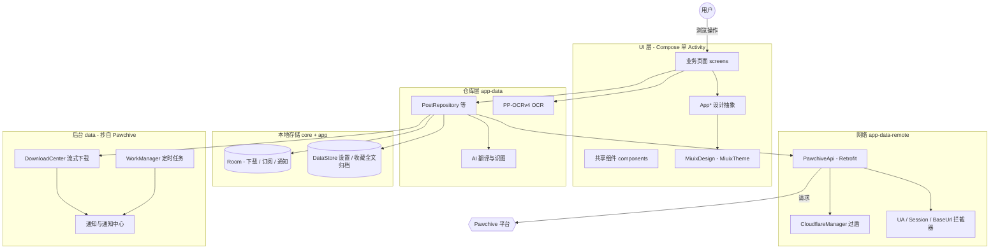

<p align="center">
  
</p>

<h1 align="center">Archive</h1>

<p align="center">
  一款精致、流畅的第三方 Android 客户端，为你带来 <a href="https://pawchive.pw">Pawchive</a> 平台的完整体验。<br/>
  基于 Kemono 的内容归档站：聚合 Patreon、Fanbox 等平台的创作者内容，支持浏览、搜索、收藏、下载与端上 OCR。<br/>
  采用 Miuix（HyperOS 风格）的 Jetpack Compose 单视觉主题。
</p>

<p align="center">
  <a href="https://github.com/Aerunox/Archive/releases/latest"></a>
  
  
  
</p>

> [!IMPORTANT]
> 项目已开源且仅供交流和学习使用，不得用于任何商业用途。本应用是纯客户端：不内置、不转存任何内容，
> 不上传任何用户数据，无统计 SDK；所有内容版权归属原站与各著作者。站点含成人内容：首次启动有
> 18+ 确认，可选缩略图模糊与禁止截屏。请支持原站 Pawchive。

---

## 功能亮点

### 内容浏览
- **首页信息流**：Paging 3 按需分页（首屏一页 50 条，滚动近底部才取下一页，对齐推特/JHenTai 的适量加载），关键词防抖搜索；可选「同作者仅显示一条」「隐藏已收藏创作者」；列表/网格双布局切换
- **列表封面用缩略图**：信息流/搜索/作者页/收藏页的封面按缩略图加载（省掉每张卡的原图大流量），原图只在媒体查看器与详情大图出现
- **发现页**：9 万+ 创作者全量缓存到本地，本地搜索与 service 筛选、按更新或收藏排序、一键同步；行内点开原地展开详情面板
- **帖子详情**：完整正文（HTML 渲染）、标签、上/下一篇、评论、修订历史、附件批量下载（按钮展开为步进器）
- **翻译横幅**：X 风格「文A 翻译自{源语言} · 显示原文」—— 蓝色链接在译文与原文间切换，源语言按文字体系本地猜测；译文按原结构**原地替换**，段落层级与原文严格对齐

### 精准搜索
- **关键词搜索**：帖子 / 创作者 / 离线归档三 Tab
- **文件哈希反查**：粘贴文件哈希（MD5 / SHA-256）追踪素材出处，支持 Discord 结果
- **离线归档搜索**：在本地收藏的帖子全文里搜索（收藏帖打开过详情页即自动建立全文缓存），断网可用
- **搜索历史**：本地持久化，保留条数可配置（5–50），支持单条删除

### 沉浸式媒体
- **大图查看**：翻页浏览 + 双指缩放，连续滑到相邻帖子的另一种媒体
- **视频播放**：Media3 ExoPlayer，X 风格海报格；站点未导入的视频走 HLS 临时流
- **多级清晰度**：列表封面加载缩略图，点进媒体查看器后加载原图；缺失时自动无感回退
- **GIF / 音频**：Coil 动图与音频附件行内播放

### 收藏与账号
- **多账号切换**：账号间收藏 / 历史 / 下载数据隔离
- **云端收藏**：登录后同步收藏的帖子与创作者，写入后即时失效缓存；离线时操作自动排队，联网后后台补写
- **本地收藏**：无需登录；收藏帖打开详情页时自动建立全文缓存（离线搜索 / 离线阅读的数据源）
- **离线阅读**：网络加载失败时，详情页自动回退到本地收藏全文缓存，正文照常阅读
- **浏览历史**：本地持久化，无需登录

### 内容订阅与通知
- **订阅创作者**：新帖自动周期检测（间隔可调，最小 15 分钟）；可选「收藏即订阅」
- **系统通知**：检测到新帖即时推送，可随时关闭
- **应用内通知中心**：首页铃铛直达，未读数角标实时刷新；单条 / 全部已读，订阅管理页随时退订

### 下载中心
- **HTTP Range 断点续传**：暂停保留临时文件，应用重启后继续仍从断点续传
- **独立任务通知**：每条任务一个通知，实时显示百分比 / 速度 / 剩余时间，通知内可暂停、继续、取消
- **后台持续下载**：`dataSync` 前台服务保活，切后台不中断
- **可控参数**：并发上限（1–5）、失败重试（1–3）、仅 Wi-Fi 下载、SAF 自定义目录、文件命名格式

### AI 与 OCR
- **多供应商 AI**：OpenAI Chat/Responses、Anthropic、Gemini；多模型档案与「用途指派」（翻译、识图分别指定档案）
- **深度思考与联网搜索**开关（默认全关），连通性测试一并验证开关被端点接受
- **端上 OCR**：PP-OCRv4（PaddleOCR）文字识别，ONNX Runtime 推理，模型与字典随包内置

### 个性化设置
- **多语言**：12 种语言资源（简体中文默认，含阿拉伯语整页 RTL），切换后杀进程仍保持
- **外观**：配色 6 态（System/Light/Dark/Monet 三种），Monet 动态取色 + 种子色；**即时切换、无需重启**，返回栈保留
- **隐私与安全**：模糊缩略图、禁止截屏（FLAG_SECURE）
- **内容屏蔽**：已屏蔽作者 / 已屏蔽帖子
- **维护**：自动清理缓存（容量阈值 + 四档频率）、每日自动备份、应用内检查更新（读取 GitHub Release）

---

## 技术架构

| 类别 | 技术选型 | 说明 |
|------|---------|------|
| **语言** | Kotlin 2.3.21 | 由 AGP 9.4.1 内置，无需单独应用 Kotlin 插件 |
| **最低 SDK** | API 30 (Android 11) | 覆盖绝大多数活跃设备 |
| **目标 / 编译 SDK** | 36 / 37 | navigation、coil、media3 等 AAR 元数据要求 API 37 |
| **UI 框架** | Jetpack Compose（BOM 2026.09.00） | 单一 Compose 代码库，单 Activity |
| **设计语言** | Miuix 0.9.4（锁定） | HyperOS 风格，业务页面只依赖 `App*` 抽象组件 |
| **模块化** | 3 个 Gradle 模块 | `app` / `data` / `core`（后两者抄自 Pawchive） |
| **依赖注入** | Hilt + KSP | `@HiltAndroidApp` / `@HiltViewModel` |
| **本地存储** | Room 2.8.5 + DataStore 1.2.1 | 下载 / 订阅 / 通知 / 下载规则用 Room；收藏全文归档（离线搜索与阅读）与设置用 DataStore |
| **下载引擎** | 自研 OkHttp 流式下载 | 单连接 + Range 断点续传（源自 Pawchive 1.7.0+） |
| **网络层** | Retrofit 3.0.0 + OkHttp 5.5.0 | kotlinx.serialization JSON |
| **图片加载** | Coil 3.6.3 | gif / video / network-okhttp 扩展齐备 |
| **视频播放** | AndroidX Media3 1.11.1 | ExoPlayer + HLS + OkHttp 数据源 |
| **OCR 推理** | ONNX Runtime 1.22.0 | Android 与 JVM 单测共用同一套模型 |
| **后台任务** | WorkManager 2.12.0 | 周期订阅同步、自动备份、缓存清理 |
| **构建工具** | Gradle 9.8.0 | 版本目录（`libs.versions.toml`）统一管理 |

### 架构总览



---

## 核心技术亮点

### 1. 单一 Compose 代码库与设计系统抽象

业务页面（20 个）只调用 `AppScaffold / AppTopBar / AppCard / …` 抽象组件（`ui/design/DesignComponents.kt`
接口），由 `ArchiveTheme` 通过 CompositionLocal 注入唯一实现 `MiuixDesign`；颜色统一收敛到
`PurrColors` 令牌：

- **配色切换零重启**：模式切换 = DataStore 状态变化 → 重组，Activity 不重建，NavHostController
  提升到主题外层，**返回栈在切换后保留**
- **与 Miuix 官方文档逐条对齐**：`ThemeController + MiuixTheme(controller=…)` 写法、
  Scaffold 弹窗容器约束、下拉刷新以 `MiuixScrollBehavior(canScroll = { false })` 作检测挂载点
- **列表安全写法**：LazyColumn 内容 lambda 里对可能为空的状态一律 `firstOrNull` + `?.` + `orEmpty`

### 2. Lucide 图标生成管线

应用内图标统一使用 [Lucide](https://lucide.dev)（ISC 许可）：`tools/gen_lucide_icons.py` 拉取官方 SVG、
把 24×24 描边几何逐点转换为 Compose `ImageVector`（生成文件，注释标明不要手改），与 Compose 版本
零耦合、可随时重新生成；`LucideIconsTest` 校验每个图标的路径数据与视口。

### 3. 结构保真的 AI 翻译契约

帖子翻译要求「逐句对应、原地替换」，输出用**哨兵分段**（`<<<TITLE` / `<<<HTML`）而不是 JSON ——
实测模型经常在 JSON 字符串里裸换行导致整段非法：

- 解析按可靠性降级：哨兵分段 → JSON 修补 → 兜底
- **占位照抄护栏**：模型把格式说明当译文照抄时直接报错，绝不把占位文字渲染出来
- **假翻译检测**：译文与原文逐字符比对（忽略空白），完全相同即报错，不伪装成功

### 4. Cloudflare 托管挑战自动过盾

`CloudflareManager`（抄自 Pawchive）通过隐藏 WebView 执行 JS 挑战，提取 `cf_clearance` 并与其
User-Agent 绑定注入后续 OkHttp 请求：单飞机制复用同一 `CompletableDeferred`、加密存储 25 分钟 TTL、
403 自动刷新重试，图片加载走同一通道。

### 5. 端上 OCR 管线

PP-OCRv4 检测 + 识别双模型，ONNX Runtime 推理，模型与字典随包内置；同一套模型在 JVM 单测里
跑真实推理，验证预处理 / 后处理与 PaddleOCR 官方管线对齐。

### 6. 智能拦截器链

- **Base URL 重写**：站点可能迁移域名，拦截器按设置即时改写 scheme/host/port，路径 `/api/v1` 不变
- **会话注入**：手动粘贴的完整 Cookie 头按分号拆段后精确取 `session=` 段
- **日志透明**：OkHttp BASIC 日志便于排查，release 不含明文密钥打印

---

## 项目结构

```
Archive/
├── app/                    # UI 层：screens / components / design / navigation / ocr
├── core/                   # 抄自 Pawchive：Retrofit API / 过盾 / 加密会话 / Room
├── data/                   # 抄自 Pawchive：下载引擎 / 订阅 / 搜索历史 / 工作线程
├── docs/                   # 架构说明 / API 验证记录 / 本地化待办 / OpenAPI 归档
├── tools/                  # 图标生成等脚本
└── gradle/libs.versions.toml   # 版本目录（依赖单一事实来源）
```

**依赖方向**：`:app` → `:data` / `:core`

---

## 快速开始

### 环境要求
- **Android Studio**（AGP 9.4）或命令行 Gradle 9.6+
- **JDK** 17+（建议 21）
- **Android SDK** Platform 37（compileSdk）与 build-tools 36.0.0

### 克隆 & 构建

```bash
git clone https://github.com/Aerunox/Archive.git
cd Archive
./gradlew assembleRelease
```

> APK 输出路径：`app/build/outputs/apk/release/`。release 变体按 ABI 永久拆分：
> 四个单架构 APK（`armeabi-v7a` / `arm64-v8a` / `x86` / `x86_64`）+ 一个 universal 包，
> 命名 `Archive-<版本>-<buildType>-<abi|universal>.apk`。

### 常用任务

```bash
./gradlew :app:testDebugUnitTest      # 单元测试（19 个）
./gradlew :app:compileDebugKotlin     # 快速编译检查
```

### 安装

下载最新 APK 安装到 **Android 11+** 设备即可：[Releases](https://github.com/Aerunox/Archive/releases/latest)。
release 包为调试签名，可直接安装、同签名覆盖升级。

---

## 权限说明

| 权限 | 用途 |
|------|------|
| `INTERNET` | 网络请求 |
| `ACCESS_NETWORK_STATE` | 网络状态检测（仅 Wi-Fi 下载、网络可用性判断） |
| `POST_NOTIFICATIONS` | 下载进度通知与内容更新通知（Android 13+ 运行时申请；拒绝后浏览不受影响） |
| `FOREGROUND_SERVICE` | 下载前台服务 |
| `FOREGROUND_SERVICE_DATA_SYNC` | 下载前台服务类型（Android 14+ 强制声明，保证后台下载不被中断） |

---

## 工程质量

| 机制 | 说明 |
|------|------|
| **单元测试** | 19 个测试类：AI 请求体与协议（含 Anthropic 采样参数互斥）、翻译哨兵解析、HTML 解析（实体单遍解码）、分页源、搜索相关度、URL 推导、OCR 真实推理、图标完整性等 |
| **R8** | release 开启混淆与资源压缩，产物按 ABI 拆分 |
| **崩溃诊断** | 全局崩溃捕获（源自 Pawchive），落盘可导出 |
| **语言资源** | 12 种语言；设置分类行标题已覆盖，部分业务文案仍为硬编码中文（持续补齐） |

---

## 相关文档

| 文档 | 内容 |
|------|------|
| [docs/ARCHITECTURE.md](docs/ARCHITECTURE.md) | 模块职责、关键调用链、修改风险区（改动前必读） |
| [docs/API_NOTES.md](docs/API_NOTES.md) | 站点端点与契约验证记录 |
| [docs/I18N_BACKLOG.md](docs/I18N_BACKLOG.md) | 本地化待办 |
| [tools/gen_lucide_icons.py](tools/gen_lucide_icons.py) | Lucide 图标生成脚本（加图标唯一正确入口） |

---

## 贡献

欢迎提交 Issue 和 Pull Request。提交前请确保：

1. 代码风格与现有代码保持一致
2. 页面开发只依赖 `App*` 抽象组件与 `PurrColors` 令牌，不直接引用 Miuix 类型
3. 新增图标走 `tools/gen_lucide_icons.py`，不手改 `LucideIcons.kt`
4. 核心逻辑改动附带单元测试

---

## Star 趋势

<p align="center">
  <a href="https://star-history.dera.page/#Aerunox/Archive&Date">
    <picture>
      <source media="(prefers-color-scheme: dark)" srcset="https://star-history.dera.page/svg?repos=Aerunox/Archive&type=Date&theme=dark" />
      <source media="(prefers-color-scheme: light)" srcset="https://star-history.dera.page/svg?repos=Aerunox/Archive&type=Date" />
      
    </picture>
  </a>
</p>

图表由 [Star History](https://star-history.dera.page/how-to-use) 实时渲染（`<picture>` 会自动跟随 GitHub 明暗主题）。仓库转为公开后即可正常出图。

---

## 开源协议

本项目以 [GNU GPL-3.0](LICENSE)（GNU 通用公共许可证第 3 版）发布。**传染性 Copyleft**：任何基于本项目的修改版或衍生作品（包括修改后重新分发的 APK），都必须以 GPL-3.0 公开完整对应源码，不得闭源。

`core/` 与 `data/` 模块源自 [Pawchive](https://github.com/Aerunox/Pawchive)（MIT License，同一作者，已随本项目转为 GPL-3.0）。第三方依赖各自遵循其原始许可（Apache-2.0 / MIT / BSD 等，均与 GPL-3.0 兼容）。

---

<p align="center">
  <sub>图标资源来自 <a href="https://lucide.dev">Lucide</a> · 主题基于 <a href="https://github.com/miuix-kotlin-multiplatform/miuix">Miuix</a> · 数据来自 <a href="https://pawchive.pw">Pawchive</a> 平台</sub>
</p>
